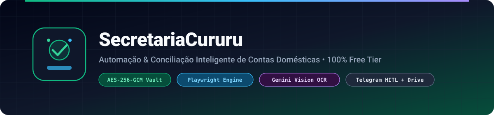
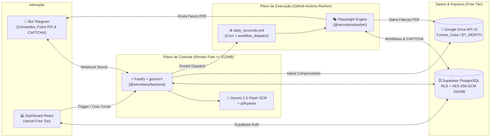

<div align="center">



<br />

### Automação Declarativa de Faturas Domésticas, Cofre AES-256-GCM, Armazenamento no Google Drive e Conciliação via Bot do Telegram + Gemini Vision OCR — **100% Free Tier**

<p align="center">
  <a href="https://github.com/lucasdlg5/SecretariaCururu/actions/workflows/ci.yml">
    
  </a>
  <a href="https://github.com/lucasdlg5/SecretariaCururu/actions/workflows/daily_reconcile.yml">
    
  </a>
  = 22" />
  
  
  
  
  <a href="./LICENSE">
    
  </a>
</p>

<p align="center">
  <a href="#-o-problema--a-solução">Visão Geral</a> •
  <a href="#-arquitetura-100-free-tier">Arquitetura</a> •
  <a href="#-segurança-zero-plaintext-aes-256-gcm">Segurança</a> •
  <a href="#-motor-declarativo-playwright">Motor Playwright</a> •
  <a href="#-quickstart--instalação">Quickstart</a> •
  <a href="#-histórico-de-issues--bugs-corrigidos">Issues & Bugs Corrigidos</a> •
  <a href="./docs/ARCHITECTURE.md">ARCHITECTURE.md</a>
</p>

</div>

---

## 📌 Sumário (Table of Contents)

- [🎯 O Problema & A Solução](#-o-problema--a-solução)
- [🏗️ Arquitetura 100% Free Tier](#-arquitetura-100-free-tier)
- [🛡️ Segurança Zero Plaintext (AES-256-GCM & Pino Redactor)](#️-segurança-zero-plaintext-aes-256-gcm--pino-redactor)
- [🎭 Motor Declarativo Playwright & Templates Inclusos](#-motor-declarativo-playwright--templates-inclusos)
- [📱 Fluxo do Bot Telegram (grammY + Gemini Vision OCR)](#-fluxo-do-bot-telegram-grammy--gemini-vision-ocr)
- [💻 Dashboard Web & Wizard de Novo Processo](#-dashboard-web--wizard-de-novo-processo)
- [📂 Mapa do Monorepo (`pnpm` Workspaces)](#-mapa-do-monorepo-pnpm-workspaces)
- [🚀 Quickstart & Instalação](#-quickstart--instalação)
- [🔐 Guia de Configuração de Secrets (Cloud & Free Tier)](#-guia-de-configuração-de-secrets-cloud--free-tier)
- [🐛 Histórico de Issues & Bugs Encontrados e Corrigidos](#-histórico-de-issues--bugs-encontrados-e-corrigidos)
- [🗺️ Roadmap & Ecossistema GitHub](#️-roadmap--ecossistema-github)
- [🤝 Contribuindo & Licença](#-contribuindo--licença)

---

## 🎯 O Problema & A Solução

Gerenciar contas domésticas todos os meses (Energia, Água, Gás, Internet, Condomínio e Aluguel) envolve múltiplos portais lentos, modais promocionais inesperados, CAPTCHAs, downloads manuais de PDFs e arquivamento desorganizado de comprovantes bancários.

| Desafio Comum | Como o **SecretariaCururu** Resolve |
| :--- | :--- |
| **Estouro de RAM no Free Tier (`512 MB`)** | O Backend Fastify + Bot Telegram roda leve no **Render Free**, enquanto o Chromium pesado do **Playwright** executa nos runners gratuitos do **GitHub Actions** (`cron` diário + `workflow_dispatch` via Octokit). |
| **Portais que mudam seletores ou exibem modais** | Motor 100% **declarativo em JSONB** validado por **Zod**, com primitiva `dismiss_optional_modal` que fecha avisos ("Mais tarde", "Agora não", "PIX Automático") sem quebrar o fluxo. |
| **CAPTCHAs bloqueantes em portais** | Primitiva `captcha_hitl`: captura screenshot do CAPTCHA, envia no **Telegram** e faz polling no **Supabase** por até 5 minutos aguardando a resposta do usuário (ou envia link direto do portal em desafios Turnstile/reCAPTCHA). |
| **Risco de vazamento de CPFs e senhas** | Política **Zero Plaintext**: credenciais criptografadas com **AES-256-GCM** (`APP_MASTER_KEY`), códigos de barras salvos apenas como hash **SHA-256** e logger **Pino** com redação automática de CPFs, e-mails, boletos e tokens. |
| **Conciliação manual de comprovantes PIX** | Envie uma **foto ou PDF** do comprovante no chat do Telegram: o bot extrai o valor via `pdf-parse` ou **Gemini 2.5 Flash Vision**, faz match automático (`±R$ 0,05`) ou exibe `InlineKeyboard` de 1 clique se houver juros/desconto. |

---

## 🏗️ Arquitetura 100% Free Tier

> Consulte o documento completo de engenharia em [**`docs/ARCHITECTURE.md`**](./docs/ARCHITECTURE.md) para detalhes sobre invariantes de sistema e diagramas de sequência.



### Matriz de Custos e Limites do Free Tier

| Serviço | Papel no Sistema | Cota Gratuita Utilizada | Consumo Estimado do Projeto |
| :--- | :--- | :--- | :--- |
| **Render** | Backend Fastify + Webhook Telegram | 750h/mês, `512 MB RAM` | `~65 MB RAM` (Zero instâncias de browser) |
| **GitHub Actions** | Worker Playwright (`chromium`) | 2.000 min/mês (público: ilimitado) | `~3 min/dia` (`~90 min/mês`) |
| **Supabase** | PostgreSQL + Auth + RLS | `500 MB` DB, 50.000 MAUs | `< 15 MB/ano` (apenas metadados e logs sanitizados) |
| **Google Drive API** | Armazenamento de PDFs e Comprovantes | `15 GB` Google Account | `~50 MB/ano` (`~120 PDFs/imagens por ano`) |
| **Google AI Studio** | OCR de fotos de comprovantes (`@google/genai`) | `gemini-2.5-flash` Free Tier | `~10 a 15 requisições/mês` |
| **Vercel** | Hospedagem do Dashboard React + Vite | 100 GB bandwidth/mês | SPA estática (`< 1 MB` gzip) |

---

## 🛡️ Segurança Zero Plaintext (AES-256-GCM & Pino Redactor)

O **SecretariaCururu** foi desenhado seguindo o princípio de que o banco de dados e os logs nunca devem conter informações sensíveis em texto puro.

| Parâmetro de Segurança | Implementação em [`@secretaria/shared`](./packages/shared/src) |
| :--- | :--- |
| **Algoritmo de Criptografia** | `AES-256-GCM` nativo via `node:crypto` ([`crypto.ts`](./packages/shared/src/crypto.ts)) |
| **Chave Mestra (`APP_MASTER_KEY`)** | 256 bits (32 bytes em Hex de 64 caracteres ou Base64 de 44 caracteres), exclusiva via variável de ambiente |
| **Vetor de Inicialização (IV)** | 96 bits (`12 bytes`) gerados com `randomBytes(12)` a cada operação de escrita |
| **Tag de Autenticação (MAC)** | 128 bits (`16 bytes` `authTag`) verificados obrigatoriamente antes da descriptografia em memória |
| **Interpolação em Memória** | Placeholders `{{secret:UC_NUMBER}}` ou `{{secret:CPF}}` são resolvidos apenas em tempo de execução no Worker |
| **Pino Log Redactor** | Mascara automaticamente CPFs (`[REDACTED_CPF]`), e-mails (`[REDACTED_EMAIL]`), linhas digitáveis de 44–48 dígitos (`[REDACTED_BARCODE]`), tokens Bearer e valores dinâmicos ([`redactor.ts`](./packages/shared/src/redactor.ts)) |

---

## 🎭 Motor Declarativo Playwright & Templates Inclusos

O Worker ([`apps/worker/src/engine.ts`](./apps/worker/src/engine.ts)) não possui nenhum código específico de concessionária hardcoded. Ele interpreta arrays JSONB validados pelo schema `WorkflowStepsArraySchema` do **Zod**:

### Primitivas Suportadas

| Primitiva (`action`) | Exemplo de Configuração JSONB | Comportamento no Worker |
| :--- | :--- | :--- |
| `goto` | `{ "action": "goto", "url": "https://..." }` | Navega até a URL aguardando `domcontentloaded`. |
| `fill_secret` | `{ "action": "fill_secret", "selector": "#cpf", "secretKey": "CPF" }` | Descriptografa `CPF` em memória e preenche o campo sem logar o valor. |
| `click` | `{ "action": "click", "selector": ".card", "textFallback": "{{secret:UC_NUMBER}}" }` | Clica no seletor CSS ou usa busca textual interpolada como fallback. |
| `dismiss_optional_modal` | `{ "action": "dismiss_optional_modal", "selector": "button:has-text(\"Agora não\")", "timeoutMs": 4000 }` | Fecha modais promocionais se aparecerem; **nunca falha** caso o modal não exista. |
| `wait_for` | `{ "action": "wait_for", "selector": "table", "timeoutMs": 15000 }` | Aguarda visibilidade do elemento no DOM. |
| `captcha_hitl` | `{ "action": "captcha_hitl", "imageSelector": "#captcha", "inputSelector": "input[name=captcha]" }` | Tira screenshot do CAPTCHA, envia no Telegram e faz polling no Supabase por 5 min. |
| `extract_value` | `{ "action": "extract_value", "selector": ".valor", "regex": "R\\$\\s*([\\d\\.,]+)" }` | Extrai valor em R$ da tela (com fallback automático via `pdf-parse` no PDF baixado). |
| `download_pdf` | `{ "action": "download_pdf", "triggerSelector": "button:has-text(\"Baixar\")" }` | Captura evento `download` do Playwright ou intercepta resposta HTTP `application/pdf`. |

### Presets Prontos para Uso ([`packages/shared/src/templates.ts`](./packages/shared/src/templates.ts))

1. ⚡ **Luz — EDP (`WEB_AUTOMATION`)**: Login com `{{secret:EMAIL}}` e `{{secret:PASSWORD}}` -> seleção de `{{secret:UC_NUMBER}}` -> dispensa modais *"Mais tarde"* (atualização cadastral) e *"Agora não"* (PIX Automático) -> *"Abrir essa conta"* -> *"Visualizar fatura"* -> *"Baixar"*. Inclui **fluxo de fallback** para 2ª via simplificada por CPF + UC em São Paulo.
2. 🌐 **Internet — NJCI (`WEB_AUTOMATION`)**: Portal NJCI -> ícone *"Facilita"* -> preenchimento de `{{secret:CPF}}` -> resolução de `captcha_hitl` via Telegram -> *"Próximo"* -> ícone da impressora na fatura mais próxima -> *"Imprimir"*.
3. 🔥 **Gás — Comgás (`WEB_AUTOMATION`)**: Portal Comgás Virtual -> *"Login"* -> *"Residencial/Comercial"* -> `{{secret:EMAIL}}` e `{{secret:PASSWORD}}` -> dispensa modais de atualizar dados (`X`) e boas-vindas (`X`) -> *"Segunda via PDF"*.
4. 💧 **Água — Sabesp (`WEB_AUTOMATION`)**: Pré-configurado com `is_active = false`, pronto para ativação com 1 clique quando necessário.
5. 🏢 **Condomínio & Aluguel (`MANUAL_REMINDER`)**: No `trigger_day`, o bot envia lembrete automático no Telegram; ao responder com o boleto PDF/foto, salva em `Faturas` no Drive e atualiza para `PDF_CAPTURED`.

---

## 📱 Fluxo do Bot Telegram (grammY + Gemini Vision OCR)

### Organização Automática no Google Drive
Suporta dois layouts configuráveis via `DRIVE_FOLDER_LAYOUT`:
- **`BY_MONTH` (Padrão):** `Contas_Casa/{YYYY}/{YYYY-MM}/Faturas` e `Contas_Casa/{YYYY}/{YYYY-MM}/Comprovantes`
- **`BY_TYPE`:** `Contas_Casa/{CATEGORIA}/{YYYY-MM}/Faturas` e `Contas_Casa/{CATEGORIA}/{YYYY-MM}/Comprovantes`
- **Padrão de Nome de Arquivo:** `{YYYY-MM}_{CATEGORIA}_{NOME_PROVEDOR}_{TIPO}.{ext}` (ex: `2026-11_LUZ_LUZ_EDP_FATURA.pdf`).

### Comandos e Interações do Bot
- `/status` — Exibe o resumo do mês atual com status e valores de todas as contas ativas.
- `/pendentes` — Lista faturas capturadas (`PDF_CAPTURED`) ou que aguardam ação manual (`MANUAL_REQUIRED`) no mês atual e anterior.
- `/rodar <conta>` — Aciona imediatamente o Worker Playwright no GitHub Actions via `workflow_dispatch` (ex: `/rodar EDP` ou `/rodar` para todas).
- **Envio de Foto ou PDF de Comprovante:**
  - **Match Único Exato (`±R$ 0,05`):** Arquiva na pasta `Comprovantes`, atualiza o ciclo para `PAID_RECONCILED` e responde com o link do Drive.
  - **Match Ambíguo ou Valor Divergente (Juros/Desconto):** Responde com um `InlineKeyboard` listando as contas abertas ordenadas por proximidade de valor para confirmação com 1 clique.

---

## 💻 Dashboard Web & Wizard de Novo Processo

Construído em **React 18 + TypeScript + Vite + TailwindCSS v4 + Recharts** ([`apps/frontend`](./apps/frontend)):
1. **Visão Geral Mensal ([`MonthlyOverview.tsx`](./apps/frontend/src/components/MonthlyOverview.tsx)):** KPIs do ciclo (Total, Conciliado & Pago, Aberto para Pagamento, Status do Cofre AES-256-GCM), tabela interativa com links diretos para Fatura e Comprovante no Google Drive e gráfico empilhado de evolução dos últimos 6 meses por categoria.
2. **Auditoria & Logs Sanitizados ([`AuditLogsView.tsx`](./apps/frontend/src/components/AuditLogsView.tsx)):** Histórico detalhado de execuções mostrando o passo alcançado (`step_reached`), mensagens sanitizadas pelo Pino Redactor e botão **"Executar Agora (GitHub Actions)"**.
3. **Wizard de Novo Processo ([`ProviderWizard.tsx`](./apps/frontend/src/components/ProviderWizard.tsx)):** Construtor passo a passo em 3 etapas com barra de carregamento rápido de presets, adição visual das 8 primitivas Playwright, cofre de secrets e validação em tempo real com **Zod**.

---

## 📂 Mapa do Monorepo (`pnpm` Workspaces)

```text
SecretariaCururu/
├── .github/
│   ├── CODEOWNERS
│   ├── dependabot.yml
│   ├── PULL_REQUEST_TEMPLATE.md
│   ├── ISSUE_TEMPLATE/
│   │   ├── bug_report.yml
│   │   ├── feature_request.yml
│   │   ├── provider_portal_breakage.yml
│   │   └── config.yml
│   └── workflows/
│       ├── ci.yml                        # Pipeline CI (Build, Typecheck & Vitest em PRs/Push)
│       └── daily_reconcile.yml           # Cron diário (11:00 UTC) + workflow_dispatch (Playwright)
├── docs/
│   ├── ARCHITECTURE.md                   # Diagramas Mermaid, invariantes e mapa de arquitetura
│   └── assets/
│       └── banner.svg                    # Banner vetorial do projeto
├── supabase/
│   └── migrations/
│       ├── 0001_initial_schema.sql       # Tabelas, Enums, Índices, Triggers e Políticas RLS
│       └── 0002_seed_providers.sql       # Seed de Provedores (EDP, NJCI, Comgás, Sabesp, Condomínio, Aluguel)
├── packages/
│   └── shared/                           # @secretaria/shared (Dual export: Node & Browser-safe)
│       └── src/
│           ├── schemas.ts                # Schemas Zod para steps declarativos JSONB e Wizard
│           ├── crypto.ts                 # Criptografia autenticada AES-256-GCM (node:crypto)
│           ├── redactor.ts               # Sanitizador e Log Redactor Pino (CPF, e-mail, barcode, tokens)
│           ├── templates.ts              # Presets de provedores com placeholders {{secret:KEY}}
│           ├── supabase.ts               # Cliente tipado Supabase + conversores BRL/centavos
│           ├── browser.ts                # Entrypoint seguro para Vite/Browser (sem node:crypto)
│           └── shared.test.ts            # 9 testes unitários Vitest
├── apps/
│   ├── backend/                          # @secretaria/backend (Fastify + grammY + Drive + Gemini OCR)
│   │   └── src/
│   │       ├── server.ts                 # Servidor Fastify, webhook autenticado e rotas REST
│   │       ├── bot/telegram.ts           # Bot grammY, comandos, HITL CAPTCHA e InlineKeyboard
│   │       ├── services/
│   │       │   ├── drive.ts              # Google Drive API v3 (BY_MONTH / BY_TYPE idempotente)
│   │       │   ├── receipt-parser.ts     # Extração via pdf-parse e @google/genai Vision
│   │       │   ├── reconciliation.ts     # Match único exato (±R$ 0,05) vs ambíguo/divergente
│   │       │   └── github-trigger.ts     # Disparo de workflow_dispatch via Octokit
│   │       └── backend.test.ts           # 7 testes unitários e de integração Vitest
│   ├── worker/                           # @secretaria/worker (Motor Declarativo Playwright)
│   │   └── src/
│   │       ├── engine.ts                 # Interpretador declarativo de workflow_steps JSONB
│   │       ├── pdf-extractor.ts          # Fallback de extração do PDF + hash SHA-256 de barcode
│   │       ├── reconcile.ts              # Orquestrador com backoff (15s, 45s, 120s) e alertas
│   │       └── worker.test.ts            # 4 testes unitários Vitest
│   └── frontend/                         # @secretaria/frontend (React 18 + Vite + Tailwind + Recharts)
│       └── src/
│           ├── App.tsx
│           ├── components/
│           │   ├── MonthlyOverview.tsx
│           │   ├── AuditLogsView.tsx
│           │   └── ProviderWizard.tsx
│           └── frontend.test.ts          # 3 testes unitários Vitest
├── CHANGELOG.md
├── CODE_OF_CONDUCT.md
├── CONTRIBUTING.md
├── LICENSE
└── SECURITY.md
```

---

## 🚀 Quickstart & Instalação

```bash
# 1. Clone o repositório
git clone https://github.com/lucasdlg5/SecretariaCururu.git
cd SecretariaCururu

# 2. Copie o template de variáveis de ambiente
cp .env.example .env

# 3. Gere uma chave mestra AES-256-GCM de 32 bytes (64 hex chars) e cole em APP_MASTER_KEY no .env
node -e "console.log('APP_MASTER_KEY=' + require('node:crypto').randomBytes(32).toString('hex'))"

# 4. Instale as dependências de todos os workspaces
pnpm install

# 5. Compile, valide a tipagem estrita e execute os 23 testes do Vitest
pnpm build
pnpm typecheck
pnpm test

# 6. Inicie o Backend (porta 3000) ou o Dashboard Frontend (porta 5173)
pnpm dev:backend
pnpm dev:frontend
```

---

## 🔐 Guia de Configuração de Secrets (Cloud & Free Tier)

<details>
<summary><b>1️⃣ Supabase (PostgreSQL + RLS + Service Role) — Clique para expandir</b></summary>

1. Crie um projeto gratuito em [supabase.com](https://supabase.com).
2. No **SQL Editor**, execute na ordem:
   - [`supabase/migrations/0001_initial_schema.sql`](./supabase/migrations/0001_initial_schema.sql)
   - [`supabase/migrations/0002_seed_providers.sql`](./supabase/migrations/0002_seed_providers.sql)
3. Em **Project Settings -> API**, copie `SUPABASE_URL`, `SUPABASE_ANON_KEY` e `SUPABASE_SERVICE_ROLE_KEY`.

</details>

<details>
<summary><b>2️⃣ Google Drive API v3 (Service Account & Pasta Contas_Casa) — Clique para expandir</b></summary>

1. No [Google Cloud Console](https://console.cloud.google.com/), ative a **Google Drive API**.
2. Crie uma **Service Account** em *IAM & Admin -> Service Accounts* e baixe a chave JSON.
3. No seu Google Drive, crie a pasta raiz `Contas_Casa` e compartilhe-a como **Editor** com o `client_email` da Service Account.
4. Copie o ID da pasta na URL para `GOOGLE_DRIVE_ROOT_FOLDER_ID` e o JSON da credencial (em linha única ou Base64) para `GOOGLE_SERVICE_ACCOUNT_JSON`.

</details>

<details>
<summary><b>3️⃣ Bot do Telegram (@BotFather) & Registro de Webhook — Clique para expandir</b></summary>

1. Crie o bot no [@BotFather](https://t.me/BotFather) (`/newbot`) e copie `TELEGRAM_BOT_TOKEN`.
2. Adicione seu Chat ID numérico em `TELEGRAM_ALLOWED_CHAT_IDS`.
3. Defina um token aleatório em `TELEGRAM_WEBHOOK_SECRET` e registre o webhook apontando para o seu serviço no Render:
   ```bash
   curl -X POST "https://api.telegram.org/bot<TELEGRAM_BOT_TOKEN>/setWebhook" \
     -H "Content-Type: application/json" \
     -d '{"url": "https://seu-backend.onrender.com/webhooks/telegram", "secret_token": "<TELEGRAM_WEBHOOK_SECRET>"}'
   ```

</details>

<details>
<summary><b>4️⃣ GitHub Actions Secrets & Personal Access Token (Octokit) — Clique para expandir</b></summary>

1. Em `Settings -> Secrets and variables -> Actions` do repositório GitHub, cadastre:
   - `APP_MASTER_KEY`, `SUPABASE_URL`, `SUPABASE_SERVICE_ROLE_KEY`, `GOOGLE_DRIVE_ROOT_FOLDER_ID`, `DRIVE_FOLDER_LAYOUT`, `GOOGLE_SERVICE_ACCOUNT_JSON`, `TELEGRAM_BOT_TOKEN`, `TELEGRAM_ALLOWED_CHAT_IDS`.
2. Crie um **Fine-grained Personal Access Token** com permissão `Actions: Read and write` e configure `GITHUB_PAT` no Backend para habilitar o comando `/rodar` e o botão **"Executar Agora"**.

</details>

---

## 🐛 Histórico de Issues & Bugs Encontrados e Corrigidos

Durante a construção e validação das 5 fases do monorepo, todos os bugs identificados pela suíte de testes e compilação estrita foram rastreados, documentados e resolvidos via **GitHub Issues**:

| Issue | Pacote Afetado | Sintoma / Erro Encontrado | Causa Raiz & Solução Implementada | Status |
| :---: | :--- | :--- | :--- | :---: |
| [**#1**](https://github.com/lucasdlg5/SecretariaCururu/issues/1) | `@secretaria/shared` | `error TS2339: Property 'provider_id' does not exist on type 'never'` em queries `.select('*')` e `.insert()` do Supabase. | O `@supabase/supabase-js` v2.49+ exige que cada tabela em `Database['public']['Tables']` declare `Relationships` e que `Row` satisfaça `Record<string, unknown>` (usando `type` em vez de `interface`). Corrigido em [`supabase.ts`](./packages/shared/src/supabase.ts). | ✅ **Fechado / Resolvido** |
| [**#2**](https://github.com/lucasdlg5/SecretariaCururu/issues/2) | `@secretaria/backend` | `error TS2322: Type 'FastifyBaseLogger' is not assignable to type 'Logger'` ao passar logger Pino customizado ao Fastify v5. | O Fastify v5 utiliza `loggerInstance` tipado como `FastifyBaseLogger`. Ajustada a integração com `createSanitizedLogger` em [`server.ts`](./apps/backend/src/server.ts). | ✅ **Fechado / Resolvido** |
| [**#3**](https://github.com/lucasdlg5/SecretariaCururu/issues/3) | `@secretaria/shared` & `@secretaria/frontend` | Falha no `vite build`: `"randomBytes" is not exported by "__vite-browser-external"`, causada pela reexportação de `node:crypto` no barrel principal. | Criado entrypoint condicional [`browser.ts`](./packages/shared/src/browser.ts) e configurado `"browser": "./dist/browser.js"` em [`packages/shared/package.json`](./packages/shared/package.json), isolando `node:crypto` apenas para ambientes Node.js. | ✅ **Fechado / Resolvido** |
| [**#4**](https://github.com/lucasdlg5/SecretariaCururu/issues/4) | `@secretaria/shared` | Risco de uma linha digitável de boleto (44–48 dígitos) sofrer match parcial pela regex de CPF de 11 dígitos antes de ser sanitizada como código de barras. | Ordenada a pipeline de sanitização em [`redactor.ts`](./packages/shared/src/redactor.ts) para executar `BARCODE_REGEX` (44–48 dígitos) e secrets dinâmicos em memória **antes** de `CPF_RAW_11_REGEX`. | ✅ **Fechado / Resolvido** |

---

## 🗺️ Roadmap & Ecossistema GitHub

O repositório utiliza recursos nativos do GitHub (Issues, Labels, Milestones, CI Workflows, Dependabot e Releases) para organizar a evolução contínua:

- [x] **Fase 1 (Milestone v1.0.0):** Estrutura do monorepo `pnpm`, migrations SQL com RLS, cofre AES-256-GCM e Pino Log Redactor.
- [x] **Fase 2 (Milestone v1.0.0):** Google Drive API v3 idempotente, Backend Fastify, Bot Telegram grammY e OCR Gemini 2.5 Flash.
- [x] **Fase 3 (Milestone v1.0.0):** Motor declarativo Playwright, templates de EDP/NJCI/Comgás/Sabesp e workflow GitHub Actions com backoff exponencial.
- [x] **Fase 4 & 5 (Milestone v1.0.0):** Dashboard React + Recharts + Wizard declarativo e governança completa do repositório.
- [ ] **Próximos Passos (Issues Abertas — Milestone v1.1.0):**
  - Suporte ao modo `EMAIL_WATCH` via Gmail API / IMAP para captura de faturas enviadas exclusivamente por e-mail.
  - Novos templates declarativos comunitários (Enel, Light, Vivo Fibra, Claro, Copasa, Sanepar).

---

## 🤝 Contribuindo & Licença

Contribuições são muito bem-vindas! Antes de abrir uma Issue ou Pull Request, leia:
- 📖 [**Guia de Contribuição (`CONTRIBUTING.md`)**](./CONTRIBUTING.md)
- 🏛️ [**Documentação de Arquitetura (`docs/ARCHITECTURE.md`)**](./docs/ARCHITECTURE.md)
- 🛡️ [**Política de Segurança (`SECURITY.md`)**](./SECURITY.md)
- 📜 [**Código de Conduta (`CODE_OF_CONDUCT.md`)**](./CODE_OF_CONDUCT.md)

Distribuído sob a licença **MIT**. Veja [`LICENSE`](./LICENSE) para mais informações.

<div align="center">
  <sub>Construído com ❤️ em Node.js 22, TypeScript, Playwright, Fastify, grammY, Supabase e React • <a href="#secretariacururu-banner">⬆ Voltar ao topo</a></sub>
</div>
