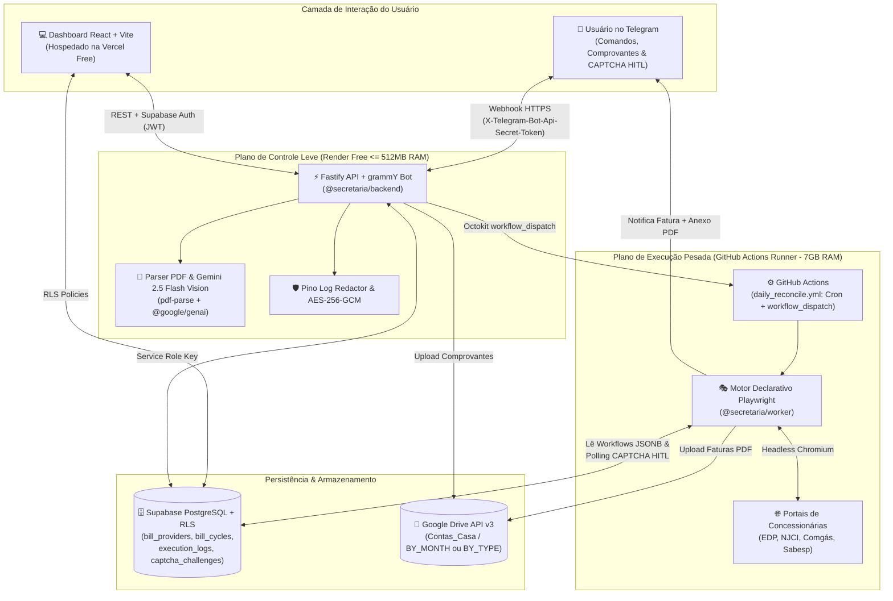
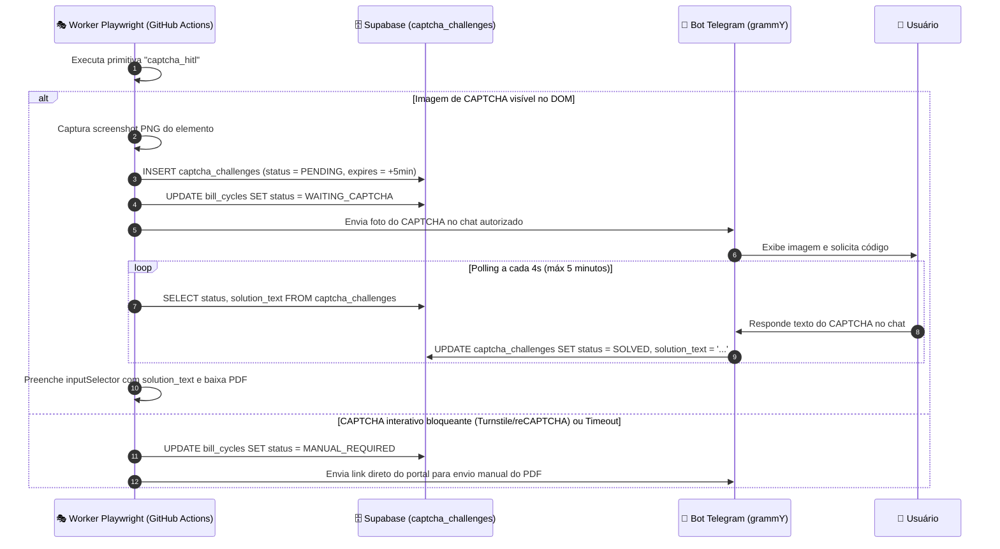
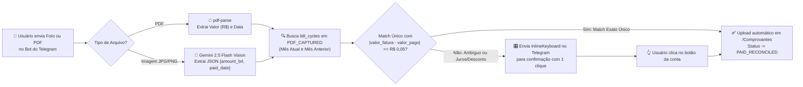

# Arquitetura & Decisões de Engenharia (`ARCHITECTURE.md`)

> Inspirado nos guias de arquitetura de referência da lista [Awesome README](https://github.com/matiassingers/awesome-readme#architecture-examples) (*esbuild, Tauri, Linux Cryptography*).

Este documento descreve a topologia de execução, o modelo criptográfico **Zero Plaintext**, as invariantes do sistema e o mapa do código-fonte do monorepo **SecretariaCururu**.

---

## 1. Visão Geral & Topologia de Execução (100% Free Tier)

O principal desafio arquitetural ao construir um sistema de automação web (headless Chromium) + API + Bot do Telegram + OCR + Dashboard no **100% Free Tier** é a **restrição de memória RAM** de containers gratuitos (como o Render Free Web Service, limitado a `512 MB RAM`).

Executar uma instância do Chromium via Playwright dentro do mesmo container que hospeda o Fastify causaria *Out-Of-Memory (OOM)* imediato. Por isso, o **SecretariaCururu** desacopla o plano de controle do plano de execução pesada:

---

## 2. Invariantes de Segurança (Zero Plaintext Policy)

1. **Invariante 1 — Nenhuma credencial em texto puro em repouso:**
   - Senhas, CPFs, e-mails de login e números de instalação (`UC_NUMBER`) nunca são gravados em claro no código, em migrations SQL ou nas tabelas do Supabase.
   - A coluna `bill_providers.encrypted_secrets` armazena exclusivamente objetos JSONB no formato `{ "KEY": { "ciphertext": "...", "iv": "...", "authTag": "..." } }` gerados com **AES-256-GCM** (`node:crypto`) e chave mestra `APP_MASTER_KEY` de 32 bytes.
2. **Invariante 2 — Sanitização obrigatória antes de logs e banco:**
   - Todo log emitido pelo Pino (`createSanitizedLogger`) e toda mensagem gravada em `execution_logs.sanitized_message` passam por `sanitizeLogText` e `redactObject`, ofuscando CPFs (`[REDACTED_CPF]`), e-mails (`[REDACTED_EMAIL]`), códigos de barras de 44–48 dígitos (`[REDACTED_BARCODE]`), tokens Bearer e valores dinâmicos dos secrets descriptografados em memória.
3. **Invariante 3 — Hash unidirecional de código de barras:**
   - Ao extrair a linha digitável de um boleto PDF, o Worker armazena apenas o hash **SHA-256** (`barcode_hash`) na tabela `bill_cycles` para detecção de duplicidade sem expor dados bancários.
4. **Invariante 4 — Isolamento de Bundle Browser vs Node:**
   - O pacote `@secretaria/shared` define `"browser": "./dist/browser.js"` em `package.json`, garantindo que o bundler Vite do Frontend importe apenas os schemas Zod, tipos e templates sem tentar empacotar `node:crypto`.

---

## 3. Fluxos de Sequência Críticos

### 3.1. Resolução de CAPTCHA Human-in-the-Loop (HITL) via Telegram
Quando um portal (como o **Internet - NJCI**) apresenta um CAPTCHA de imagem durante a execução no GitHub Actions:

### 3.2. Conciliação Inteligente de Comprovantes (Tolerância ±R$ 0,05)

---

## 4. Mapa do Código-Fonte

| Caminho | Responsabilidade Principal |
| :--- | :--- |
| [`packages/shared/src/schemas.ts`](../packages/shared/src/schemas.ts) | Schemas **Zod** discriminados para as 8 ações declarativas do Playwright e validação do Wizard. |
| [`packages/shared/src/crypto.ts`](../packages/shared/src/crypto.ts) | Criptografia autenticada **AES-256-GCM** (`encryptSecret`, `decryptSecret`, `interpolateSecrets`). |
| [`packages/shared/src/redactor.ts`](../packages/shared/src/redactor.ts) | Sanitizador regex e hook de redação do logger **Pino** (`sanitizeLogText`, `redactObject`). |
| [`packages/shared/src/templates.ts`](../packages/shared/src/templates.ts) | Templates declarativos para **EDP**, **NJCI**, **Comgás**, **Sabesp**, **Condomínio** e **Aluguel**. |
| [`packages/shared/src/supabase.ts`](../packages/shared/src/supabase.ts) | Tipagem completa da base `Database` para `@supabase/supabase-js` v2.49+ e conversores de moeda BRL. |
| [`apps/backend/src/services/drive.ts`](../apps/backend/src/services/drive.ts) | Criação idempotente de pastas no Google Drive (`BY_MONTH` e `BY_TYPE`) e upload padronizado. |
| [`apps/backend/src/services/receipt-parser.ts`](../apps/backend/src/services/receipt-parser.ts) | Extração de valores de comprovantes via `pdf-parse` e `@google/genai` (`gemini-2.5-flash`). |
| [`apps/backend/src/services/reconciliation.ts`](../apps/backend/src/services/reconciliation.ts) | Algoritmo de conciliação com tolerância de `±5` centavos e ordenação por proximidade de valor. |
| [`apps/backend/src/bot/telegram.ts`](../apps/backend/src/bot/telegram.ts) | Bot **grammY** com whitelist de chat, comandos `/status`, `/pendentes`, `/rodar`, HITL e callbacks. |
| [`apps/worker/src/engine.ts`](../apps/worker/src/engine.ts) | Interpretador declarativo do Playwright sem fluxos hardcoded. |
| [`apps/worker/src/reconcile.ts`](../apps/worker/src/reconcile.ts) | Orquestrador com backoff exponencial (`15s`, `45s`, `120s`), `NOT_FOUND_YET` silencioso e alertas. |
| [`apps/frontend/src/components/ProviderWizard.tsx`](../apps/frontend/src/components/ProviderWizard.tsx) | Construtor visual passo a passo de processos de fatura com presets e validação Zod. |
